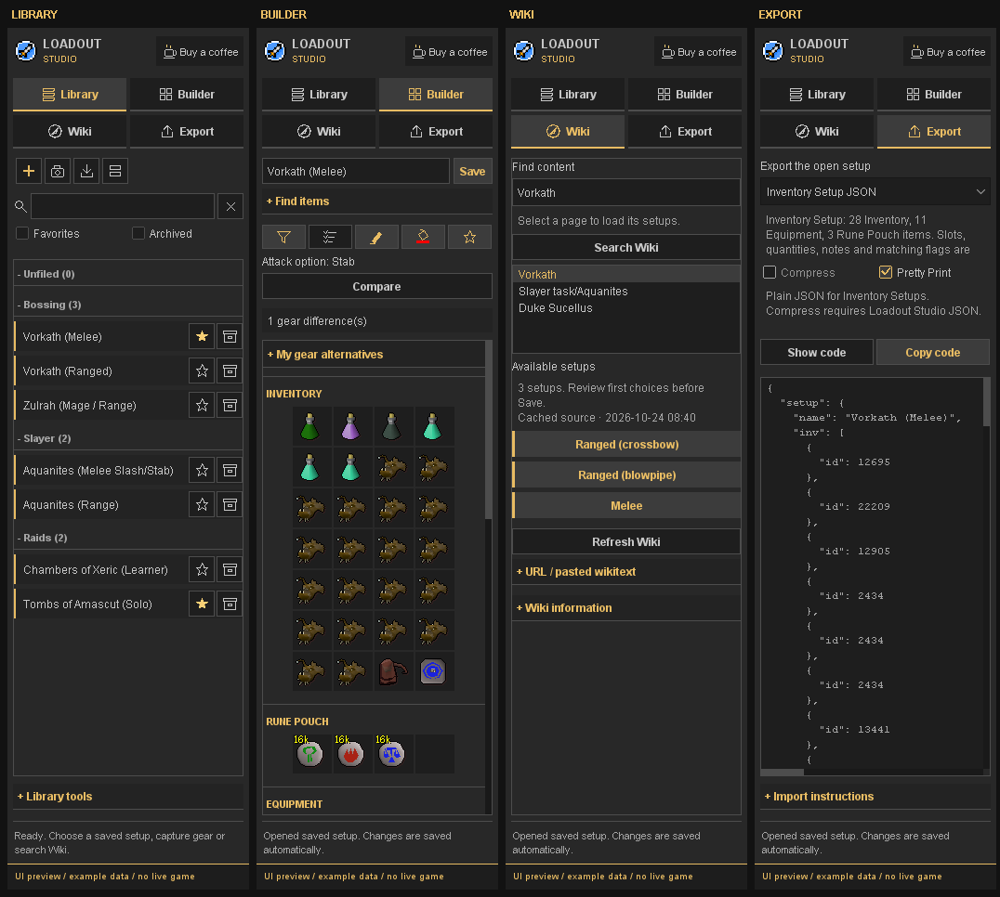
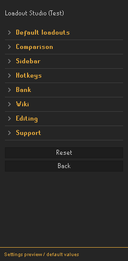
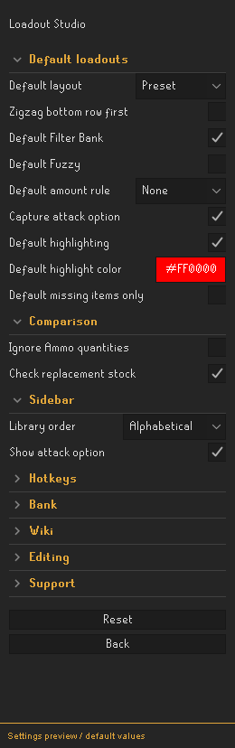
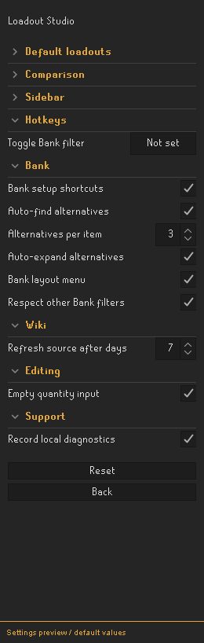

# Loadout Studio

Create and organise gear setups for Old School RuneScape. Find loadouts on the OSRS Wiki, edit your Inventory and Equipment, and use your setups with Bank Tags or Inventory Setups.

**Current version: 0.9.1-rc.9.** Loadout Studio is a release candidate and is not yet available through the RuneLite Plugin Hub. Docker is not required to run the plugin or the Java/Gradle test client.

Loadout Studio works without the Inventory Setups and standalone Bank Tag Layouts hub plugins. It owns its library, editor, comparison and codecs. Bank filtering also works with built-in **Bank Tags** disabled. Both Bank Tags states now use the same Loadout Studio view of the ordinary Bank's real widgets. Actual Bank stock counts and item child indices are preserved. Optional imports create independent copies.

## Screenshots

Offline renders of the actual sidebar using Loadout Studio's own charcoal/gold theme and example loadouts. These are UI previews, not captures of a logged-in client or proof of live Bank behavior.



[Library](docs/screenshots/library.png) · [Builder](docs/screenshots/builder.png) · [Equipment and Notes](docs/screenshots/builder-details.png) · [Owned alternatives](docs/screenshots/alternatives.png) · [Wiki choices](docs/screenshots/wiki.png) · [Export](docs/screenshots/export.png) · [Compressed export](docs/screenshots/export-compressed.png) · [Diagnostics](docs/screenshots/diagnostics.png)

The gear-difference tooltip uses a compact count per container; individual slots keep their detailed explanations. [Tooltip preview](docs/screenshots/gear-differences-tooltip.png).

Settings previews below are generated from the current configuration definitions and default values using RuneLite styling. They are documentation previews, not captures of a running native configuration window.

<table>
<tr><th>Overview</th><th>Defaults and comparison</th><th>Bank, Wiki and editing</th></tr>
<tr><td></td><td></td><td></td></tr>
</table>

## Contents

- [Getting Started](#getting-started)
- [Plugin Preferences](#plugin-preferences)
- [Creating a Setup](#creating-a-setup)
- [Your Setup Library](#your-setup-library)
- [Editing Items](#editing-items)
- [Finding Wiki Setups](#finding-wiki-setups)
- [Bank Filtering and Layouts](#bank-filtering-and-layouts)
- [Comparing Your Gear](#comparing-your-gear)
- [Importing and Exporting](#importing-and-exporting)
- [Saved Setups and Backups](#saved-setups-and-backups)
- [Support and Suggestions](#support-and-suggestions)
- [Diagnostics and Reporting](#diagnostics-and-reporting)
- [Development](#development)
- [Changelog](#changelog)

## Getting Started

Build and launch the test client using the instructions under [Development](#development). Enable **Loadout Studio** in RuneLite, then click the Combat Tutor icon in the sidebar. Built-in Bank Tags is optional.


Item identity: [compatibility audit and limitations](docs/item-id-compatibility.md).

Release candidate review: [player scenarios and release gates](docs/release-readiness.md), [Plugin Hub preparation](docs/plugin-hub/README.md) and [proposed listing and submission text](docs/plugin-hub/submission-description.md). The candidate has not been approved by RuneLite.

The sidebar has four tabs:

- **Library** — find and organise your saved setups.
- **Builder** — view and edit the selected loadout.
- **Wiki** — search for an activity and choose a setup.
- **Export** — copy a setup in the format you want to use.

## Visual Design

Loadout Studio uses its own warm charcoal surfaces, gold accents, sans-serif typography, wordmark, navigation icons and compact setup cards. Primary actions, expandable sections and Wiki setup choices have distinct treatments. OSRS item sprites, yellow stack counts and the familiar slot geometry remain intact.

The theme is applied only to this plugin's sidebar, controls and support views. RuneLite's native configuration window and in-game Bank menus retain the host's styling; other plugins' UI defaults are not changed.

## Plugin Preferences

Open the RuneLite plugin list, find Loadout Studio and click its configuration cog. General settings live here rather than in the sidebar:

- **Default loadouts:** initial layout/direction, Bank filtering, Fuzzy, amount rule, highlighting/color, missing-only matching and attack-option capture. These affect newly created blank/captured setups only. Saved setups, Wiki source choices and imports retain their own values.
- **Comparison:** ignore worn Ammo/Quiver amounts and check combined replacement stock. Rune Pouch matching remains independent.
- **Sidebar:** library order and saved attack-option display. The Buy a coffee button always remains visible in the sidebar header; there is no visibility setting.
- **Hotkeys:** the existing Bank filter hotkey.
- **Bank:** setup shortcuts, the separate Bank layout menu, respect for another active Bank filter, automatic owned alternatives, their maximum count and automatic expansion.
- **Wiki:** days before a source is refreshed on the next user open (seven by default).
- **Editing:** empty initial quantity input.
- **Support:** bounded local diagnostics; disabling recording clears the current session.

The sidebar keeps current-setup actions and overrides: Save, Compare, Bank toggle, per-setup layout, items, Notes, section and favorite. It has no global sort dropdown, Ammo preference checkbox or duplicate Compare/Export/Bank-toggle buttons. Existing config keys and saved setup data remain compatible. Restoring an older draft retains its recorded Ammo preference until a global preference change or another setup is opened.

## Creating a Setup

To save the gear you are wearing, open **Library** and click the camera button, **Capture gear**. This creates a draft from your current Inventory, Equipment, Rune Pouch, Quiver and Spellbook.

To start from scratch, click the plus button, **New setup**.

Give the setup a name in **Builder**, make any changes you need, then click **Save**. To keep the original and save another version, expand **Setup details** and choose **Save copy**.

You can also create a setup from the [Wiki](#finding-wiki-setups) or [import one](#importing-and-exporting).

## Your Setup Library

Click a setup's name to open it. New copies and duplicate imports are kept and numbered **(1)**, **(2)** and so on. Use the search bar to find setups by name, `item:<name or ID>` or `notes:<text>`. Choose Alphabetical, Recent, Favorites first or Manual sorting in **RuneLite plugin settings → Loadout Studio → Sidebar → Library order**. Right-click a setup name to move it up/down within its section; moving selects Manual order. Recent is recorded per character/profile. Long names are shortened in the list; hover over a name to see it in full.

### Favorites

Click the star beside a setup to mark it as a favorite. Enable **Favorites** to show only your favorites.

### Sections

Use the **Sections** button at the top of Library to create, rename or remove a section. To assign a setup, open it, expand **Setup details**, choose a section and click **Save**.

Click a section heading to expand or collapse it. Search and Favorites temporarily expand matching sections; clearing those filters restores your previous section state. Setups without a section appear under **Unfiled**. Removing a section moves its setups back to Unfiled.

### Archiving and Deleting

Click the archive-box icon beside a setup to move it out of the active list. Enable **Archived** to view archived setups.

Archived setups have a restore arrow and a red trash icon:

- Click the **restore arrow** to return a setup to the active list.
- Click the **trash icon** to delete it permanently. You will be asked to confirm, with **Cancel** selected by default.

If the setup is open in Builder, the confirmation also explains that its draft and unsaved changes will be discarded.

## Editing Items

Open a setup in **Builder** to see its Inventory, Rune Pouch, Equipment, Spellbook, Quiver, Additional filtered items and Notes.

Click a question-mark slot or use **Update Slot from Search** to type directly in the native chatbox. Quantity entry opens empty by default. Right-click an item slot to replace it, change its quantity, adjust matching options or remove it. **Update Slot from Search** opens RuneLite's item search in the chatbox. You can also update a slot from the corresponding item in your current Inventory or Equipment.

Expand **Find items** to search the local item list by English name or Item ID. Double-click a result, or select **Add to Inventory**, to fill the next empty Inventory slot.

### Dragging Items

Drag an item from Find items into a slot to add it to your setup. Drag between slots to move or swap items. Equipment, Rune Pouch and Quiver slots check that the item fits. Rune stacks moved to the Pouch are capped at 16k; excess is omitted from the planned setup and the source Inventory slot is cleared. A different rune already in the destination swaps into that freed slot, even when Inventory was full. This edits the setup only. The drag uses the item sprite.

These edits change the loadout you are building. Withdraw and equip your gear through the usual RuneLite controls.

### Quantities and Rune Pouch

Enter a number such as `15000`, or use a shortcut such as `15k`.

- **0** means unlimited matching: the item must be present, but its quantity is ignored.
- Rune Pouch slots have a maximum of **16,000 runes per type**.
- Inventory stacks can exceed 16,000.

Expand **Loadout options** and select **Max pouch runes (16k)** to fill the quantities of existing Rune Pouch entries. Missing Wiki quantities still need to be entered before export.

### Additional Filtered Items and Notes

Use **Loadout options → Add filtered item** for supplies you want to see in the Bank filter, such as pre-pots, without adding them to the main loadout.

Write instructions in **Notes** below the items. The notes area grows with the text and uses the sidebar's main scrollbar.

**Ctrl+F** focuses the relevant search field. **Ctrl+S** saves the draft.

### Owned Gear Alternatives

Owned alternatives are determined locally after opening a setup and after Bank/gear changes. There is no Check my Bank step by default. Open **My gear alternatives** to review the compact list; compatible owned choices expand once per setup when enabled in settings. Open the Bank at least once in the current session first. The plugin reads local Bank, Inventory and Equipment data; Bank placeholders do not count as owned items. Closed-Bank results show the observation time and can be out of date. Other storage is not included.

Concrete Equipment/Inventory setups also keep the adjacent Recommended equipment table for their own tab or table column. Its items are offered in Wiki order from most to least effective, restricted to locally observed items. Melee and Ranged choices stay separate. If a source list exists, items outside it are not suggested; footnotes and combination conditions remain in Notes. The selected concrete gear and Inventory are preserved. No additional Wiki request is needed.

Missing items without a source list offer a small compatible bundled gear/supply family, such as Torva platebody, Bandos chestplate and Fighter torso. Arbitrary items for the same slot are not suggested. At most three choices are shown by default, configurable from one to five. Requirements and source conditions still need review. The first Wiki choice remains the default; each replacement starts at **Keep original**. Select the replacements you want, then click **Use selected alternatives**. Availability is checked again before applying. By default, **Check replacement stock** also reserves combined amounts across Inventory and Equipment, including unchanged slots using a replacement item. A shortage keeps the draft unchanged and appears near the Builder actions. Explicit zero still requires at least one observed item per slot. Pouch contents and other storage are not counted in this check. Disable this check in **plugin settings → Comparison** if you want to plan beyond observed amounts; each selected replacement must still be observed. Review and Save; **Undo alternatives** is available until another draft edit makes it unsafe. Rune types are never freely substituted. No Wiki request is needed for this operation.

### Setup controls

The compact icon row controls Bank filtering, unordered missing-item matching, highlighting, highlight color and favorite state. Save per-setup changes. The saved attack option is shown under the title when enabled. Collapsible headings, action buttons and Wiki preset cards use distinct styling.

**Bank stack counts show real stock.** A desired quantity such as 16k belongs to the setup and its amount comparison; filtering does not withdraw 16k or falsify the Bank count.

### Upgrading Saved Setups

Save your current draft, then Shift-right-click an item for **Update ALL slots from Inventory/Equipment** or **Update ALL slots from Search**. Confirm before all matching saved setups, including archived ones, are updated; Undo remains under Library tools. For a selected subset, use **Library tools → Upgrade item in setups**. Choose the old and new item using chatbox search, select the active setups to change and confirm the preview. Only exact Item IDs are replaced; amounts, matching rules, Notes and layout positions are retained. Replacement Equipment must use the same slot. Review combat style and requirements yourself. **Undo last upgrade** works while no later library/draft change would be lost.

### Bolt Pouch and Attack Option

Capture gear includes a carried Bolt Pouch and the current attack option when available from the game cache. Existing Bolt Pouch entries can be edited like other slots. **Loadout options** can add four Bolt Pouch slots, capture the current attack option or clear that preference. The saved attack option is checked, never changed in game.

## Finding Wiki Setups

1. Open **Wiki** and enter an activity, such as Vorkath.
2. Press **Enter** or click **Search Wiki**.
3. Select a page. Leave **Use Strategies subpage** enabled to look for its strategy page.
4. Choose one of the available setups to open it in Builder.
5. Review the loadout and click **Save**.

The resolved page title and its source variant become the setup name. Source names such as Melee or Ranged (crossbow) are retained; table attributes are not used as names. You can rename it in Builder.

Known alternatives use the first listed item by default. When several game items share a name, the first local catalogue result is used. Items you have already selected by Item ID stay unchanged. You can replace any default through item search.

`Cheap food` defaults to Manta ray and `Cheap prayer` to Prayer potion(4). These are fixed choices, rather than a live price comparison. Source conditions and gear combinations remain in Notes. A `?` means that a source expression could not be resolved; use item search to finish that slot. A page containing only gear recommendations still needs its Inventory, quantities and Spellbook reviewed.

For a specific page, expand **URL / pasted wikitext**. Pasted wikitext can be used offline.

### Cached Pages

Fetched pages are saved automatically and reused after restarting the client. There is no Use cache button. Opening a source older than seven days requests an update; change this interval under **Wiki → Refresh source after days**. There is no background refresh. **Refresh Wiki** requests an immediate update after confirmation, with cached data retained on a failure. The panel shows when the source was fetched and whether it is out of date.

Starting the client, opening saved setups and typing in the search field do not send Wiki requests. Typing can suggest pages already in the local cache. An explicit search or page selection can contact the Wiki. The Wiki receives your IP address, search text and requested page title. Item images come from RuneLite's game cache.

See the [Wiki request policy](docs/wiki-network-policy.md) for the full caching and request limits.

## Bank Filtering and Layouts

Right-click **Show worn items → Loadout Studio → Auto Layout** for **Preset**, **Zigzag (top first)** or **Zigzag (bottom first)**. These actions open this sidebar and update only the current draft; choose Save to retain the layout. The same submenu has **Filter Bank**, **Clear filter** and optional saved-setup shortcuts. Other plugins' menu entries are kept.

**Respect other Bank filters** is enabled by default. An automatic selection or refresh yields to another active Bank Tag; use our explicit Filter Bank or Auto Layout action, or re-enable the filter in Builder, to switch deliberately. The setting does not disable or reconfigure Inventory Setups. When using both plugins, enable Inventory Setups' **Require Active Panel for Filtering** option, or close its selected setup if it keeps reapplying its own filter. The plugins share a Bank view; live handover still needs testing. Bank layout actions have a separate setting from saved-setup shortcuts.


Built-in **Bank Tags is optional**. With it disabled, Loadout Studio filters and positions real items in the ordinary Bank independently. This path does not duplicate physical stacks or include Potion Storage; confirm manual withdrawals and service transitions in the test client.

Open a setup and use **Filter Bank** / **Clear filter** above the loadout for quick access. To choose a layout, expand **Bank filtering and layout**:

- **Preset** places Equipment on the left and Inventory on the right.
- **Zigzag** alternates items between two rows. Choose which row starts first.
- **Imported / custom** keeps an imported layout's positions.

Drag items in your active Bank layout to customise their positions. These changes update the Builder draft; click **Save** to retain them across reopening/restarts. The mode becomes Custom. Choosing Preset/Zigzag explicitly regenerates positions.

A configurable **Toggle Bank filter** hotkey works only while the Bank is open and is unset by default. The worn-items button can offer up to five favorite/recent setup shortcuts; disable **Bank setup shortcuts** in config if desired.

Use the fixed **Filter Bank** button to show the setup's items now or when you next open the Bank. Click **Clear filter** to turn filtering off for the draft. Save the setup to keep these preferences.

The filter includes Equipment, Inventory, Rune Pouch, Quiver and Additional filtered items. The Bank title displays the setup name. If you are also using another setup plugin, keep one setup filter selected at a time.

## Comparing Your Gear

Gear differences update from local Inventory, Equipment, Rune Pouch, Quiver, Bolt Pouch, Spellbook and attack-option changes. Unchanged snapshots do not rebuild the sidebar; editing Notes keeps the same editor. The fixed status and slot tooltips explain differences. **Compare** also requests a fresh check. Actual event handling still requires manual RuneLite acceptance.

Unordered Inventory matching ignores extra items and requires distinct matches for duplicate required items. Exact and Fuzzy/quantity rules remain per item.

Right-click a slot to change its matching options:

- **Toggle Fuzzy** allows supported related variants, such as different charges or potion doses.
- **Stack comparison** shows **Ignore amount**, **Exactly**, **At least** and **At most**. Portable codes stay compatible with existing exports.

**Ignore Ammo quantities** is under **plugin settings → Comparison**. Imported unordered Inventory matching is also respected. Spellbook differences are checked when the setup specifies one.

Matching rules can differ between receiving plugins, particularly for custom Fuzzy groups.

## Importing and Exporting

**Pretty Print** indents Inventory Setup JSON or Loadout Studio JSON for reading. **Compress** uses GZIP + Base64 and is available only with **Loadout Studio JSON**. Compressed codes start with `loadoutstudio:gz1:` and can be pasted into **Library → Import** in Loadout Studio. Pretty Print is disabled while compression is active. Preview and Copy code use the same selected representation.

Inventory Setups expects plain JSON, and Bank Tags expects its native CSV text. Those external-plugin exports are never GZIP-wrapped; unsupported checkboxes are disabled. The normal compact Inventory Setup output stays the default. Native Loadout Studio JSON preserves item labels and source choices as well as slots, quantities, Notes and layout. Exports still require resolved items and required quantities.

### From Other Plugins

In Library, click **Import setup → From installed plugins**. Select the setups you want, review them, then choose **Save copies**. **Open copy** opens one as an editable draft.

Loadout Studio reads supported Inventory Setups, Bank Tags and legacy Bank Tag Layouts data from the current RuneLite profile. It creates independent copies and retains available section names, favorites and layouts. The originals remain in their own plugins.

If an entry is unsupported, export it through its original plugin and use **Paste JSON / Bank Tag** instead.

### Share Selected Setups or a Section

Use **Library tools → Share setups / section**, select individual setups or a section, and confirm. The bundle includes the selected setups and their Notes. Importing this bundle adds independent copies and retains existing setups; it does not replace the whole library. Whole-library backups retain their separate restore flow.

### From a Code

Click **Import setup → Paste JSON / Bank Tag**, paste an Inventory Setups export or Bank Tag code, and review the imported setup.

### Exporting a Setup

Open **Export** and choose a format. Click **Show code** to preview it or **Copy code** to copy it:

- **Inventory Setup JSON** — portable JSON for the Inventory Setups plugin.
- **Bank Tag (RuneLite)** — a native RuneLite Bank Tag, with its Bank layout.
- **Bank Tag Layouts** — a legacy layout string for that plugin's matching import action.

To import the result in Inventory Setups, use its green import icon → **Import setup… → Enter setup data**. For native Bank Tags, right-click the Bank's **+** tab and select **Import tag tab**.

**Bank Tags do not store worn Equipment slots, quantities, Spellbook, Notes or Rune Pouch contents.** Converting a Bank Tag back to an Inventory Setup puts its items in Inventory, with overflow in Additional filtered items. Fill in the missing details before using it as a complete loadout.

## Saved Setups and Backups

Your library is separated by RuneLite profile and character, with a separate library when no character is selected. RuneLite may synchronise configuration according to your RuneLite settings.

Use **Library tools → Copy library backup** to keep a backup of your saved setups.

If you leave unsaved Builder changes, Library can offer **Restore draft** when you return. Restoring opens the draft for review; click **Save** to keep it in your library.

## Support and Suggestions

Have a suggestion or found a bug? Open an [issue](https://github.com/Pa5cal1/runelite-loadout-studio/issues) with the activity name, what you expected and the steps needed to reproduce it.

### Donations

If you would like to support development, you can [buy me a coffee](https://buymeacoffee.com/pascalvdbe9). Donations are optional.

## Diagnostics and Reporting

Open **Library tools → Diagnostics / report problem** to review the current technical report. **Copy report** copies exactly the visible text. **Open GitHub issue** opens a blank report form; you choose whether to paste the report and submit it. Repository access is required while testing. No report is attached or sent automatically.

Local diagnostics are enabled by default under **Support → Record local diagnostics**. They keep fixed operation/outcome counters, total/max durations and at most 24 recent technical outcomes in memory. Counts describe calls in the current plugin session, not unique users. Wiki cache hits and actual HTTP operations have separate counters. Invalid input and expected states are distinct from unexpected exceptions.

Reports include plugin/RuneLite versions, OS family and Java specification version. They exclude setup contents, item IDs, player names, searches, URLs, raw exception messages and file paths. Unexpected faults may retain only bounded frames from this plugin's own classes. No disk persistence or telemetry endpoint is added; reset manually, disable recording, or restart the plugin/client to clear the counters. This does not capture every client error or native crash.

## Development

<details>
<summary>Building and testing the local client</summary>

Use JDK 11 and run these commands from the repository root:

```powershell
.\gradlew.bat test shadowJar jar --no-daemon
.\scripts\Launch-Test.bat
```

On Linux or macOS, build with `sh gradlew test shadowJar jar --no-daemon`.

The `*-all.jar` is the development client; the regular JAR contains the plugin. Run the development client separately from your usual RuneLite installation. For Jagex Accounts, follow RuneLite's [development-client login instructions](https://github.com/runelite/runelite/wiki/Using-Jagex-Accounts).

Source is under `src/main/java/com/loadoutstudio/`, with tests under `src/test/`. The launcher is in `scripts/` and supporting documentation is in `docs/`.

Automated tests cover data formats, item matching, layouts, caching and sidebar behaviour. In-client acceptance is still required before a Plugin Hub submission.

- [Manual test guide](docs/local-acceptance.md)
- [Validation results](docs/VALIDATION.md)
- [Sidebar design](docs/sidebar-system-design.md)
- [Plugin Hub submission notes](docs/plugin-hub/README.md)

</details>

## Changelog

### 0.9.1-rc.6

- Replace the one-line list of every gear difference with a bounded, grouped tooltip. Individual slot tooltips retain their details.
- Refresh the summary tooltip after manual Compare as well as live comparison.

### 0.9.1-rc.4

- Restore the requested Combat Tutor sword icon, filling the native 16 px sidebar tab without extra transparent margin. Header and listing versions use larger local renders.
- Keep RuneLite toolbar dimensions unchanged.

### 0.9.1-rc.3

- Fix startup: event subscribers must use RuneLite EventBus method names.
- Add a regression that registers every plugin subscription with RuneLite EventBus before release.

### 0.9.1-rc.2

- Audit item identity against Inventory Setups, Bank Tag Layouts and RuneLite; add full-range Fuzzy and declared-ID serialization regressions.
- Exclude known temporary/duplicate search items from automatic Wiki defaults and manual chatbox selections. Existing explicit import/capture IDs remain unchanged.
- Normalise Bank Tag export IDs through the client item definitions while keeping exact Inventory Setups IDs intact. Block external exports when definitions are loading or an ID is unknown.
- Repair older source-choice drafts using known temporary IDs; saved data changes only after Save.

### 0.9.1-rc.1

- Keep Slayer task recommendation pages in Wiki search results while filtering technical subpages.
- Add three-account isolation, delayed account-switch callback and rolling Wiki request-budget regression checks.
- Prepare Plugin Hub listing metadata, icon, submission guidance and a release-readiness report. This is a candidate for manual testing, not a Plugin Hub approval.

### 0.9.0-test

- Restore warm gold accents and charcoal surfaces while retaining the distinct sidebar controls and cards. Use the OSRS Combat Achievements icon in the sidebar and header.

- Give Loadout Studio a distinct charcoal/gold visual identity, sans-serif text, two-line wordmark and icon navigation.
- Restyle setup cards, section headings, Wiki choices, primary actions, checkboxes, menus and tooltips consistently within this plugin.
- Preserve item artwork, count rendering, slot dimensions, saved data and native RuneLite settings styling. No global UI defaults are changed.
- Refresh the sidebar and diagnostics screenshot gallery; verify contrast and narrow navigation labels.

### 0.8.5-test

- Keep Buy a coffee visible and remove its visibility preference. A previously stored hidden choice is ignored; other preferences are retained.
- Add settings previews for the section overview, loadout/comparison/sidebar defaults, and Bank/Wiki/editing/support options.
- Add session-only local diagnostics, bounded technical reports, copy/reset controls and a manual GitHub issue form. No automatic upload.
- Add a distinct Show worn items submenu for Preset/Zigzag, explicit filtering and saved setups. Automatically yield to another active Bank Tag by default.

### 0.8.4-test

- Add Compress and Pretty Print controls to Export, with explicit format compatibility.
- Add native Loadout Studio JSON and versioned GZIP/Base64 codes that round-trip through Import; preserve external-plugin output formats.
- Bound expanded imports to 2 MB and reject malformed compression, unsupported versions and invalid UTF-8 before schema checks.
- Verify Copy code against the visible preview for each format and update the screenshot gallery.

### 0.8.3-test

- Preserve custom Bank positions when applying an alternative; retain the old position when another slot still requires that item. Undo restores the previous arrangement.
- Show the known missing-item name even when it is absent from the Bank observation.
- Add labeled UI previews of Library, Builder, Equipment/Notes, owned alternatives, Wiki and Export to this guide.

### 0.8.2-test

- Cap oversized Inventory-to-Pouch transfers at 16k without keeping excess in the setup Inventory. A different displaced rune swaps into the freed source slot.

### 0.8.1-test

- Attach source-ordered Recommended equipment rows to concrete loadouts instead of skipping them when Equipment/Inventory templates already exist.
- Keep each tab/table column isolated, preserve the selected concrete gear and source conditions, and suggest only observed items from that source list.
- Add six regression tests based on the Aquanites source structure. No additional network requests.

### 0.8.0-test

- Prefer verified live item definitions, repair known obsolete Wiki ring IDs in drafts, and resolve nested item templates and dose-less potion names locally.
- Save/reuse Wiki cache automatically, refresh stale sources only on user opening, prefer Strategies and hide technical suggestions. Preserve source variant names and correct table header parsing.
- Find ordered, setup-compatible owned alternatives automatically in a compact list without rebuilding Notes; cap the displayed choices.
- Focus native chatbox input, start quantity entry empty, draw item drag images, and safely cap Pouch transfers while retaining remainder stacks.
- Allow partial Bank filtering with unresolved slots and add a standalone ordinary-Bank view when built-in Bank Tags is disabled.
- Add per-setup icon controls, clearer section styling, visible attack options, Shift-right-click bulk updates and numbered duplicate names.
- Extend native settings and sidebar sizing constraints. Live Windows drag, Bank service transitions and game-window resize still require user acceptance.

### 0.7.3-test

- Preserve Library favorite changes through Builder Save, Save copy and unsaved draft recovery.
- Reject malformed boolean fields in imports, library metadata and recovery before they reach the editor.
- Keep the current draft intact when new data fails validation; show actionable errors beside Library, Builder and Export controls.
- Use plain amount-rule labels, compact Wiki feedback and a short choose, review, Save, Bank introduction.
- Check combined observed stock before applying owned replacements, with an option under Comparison settings.
- Add permanent regression coverage and a current [manual test checklist](docs/local-acceptance.md).

### 0.7.2-test

- Keep slot menus, Library ordering menus, item choices and import/share review content consistent with the sidebar fonts and dark controls.

### 0.7.1-test

- Move general preferences into five collapsible RuneLite configuration sections.
- Persist library sorting in config and keep manual row ordering available through right-click.
- Apply new-loadout defaults only to blank/captured setups, preserving imported and saved values.
- Remove duplicate sidebar actions and keep the current setup controls available.
- Apply display/comparison preference changes without rebuilding the Notes editor.

### 0.7.0-test

- Offer explicitly selected alternatives from locally observed gear, with source/group/same-slot explanations, availability recheck and guarded Undo.
- Update gear differences from local changes, fix unordered extra-item behavior and add Bolt Pouch/attack-option support.
- Save native Bank layout edits back into the active draft as Custom.
- Add Recent, Favorites-first and Manual ordering, item/Notes searches, bulk item upgrade with preview/Undo, and selected sharing bundles.
- Add configurable Bank filter hotkey and favorite/recent Bank-menu shortcuts.
- Keep Inventory Setups and standalone Bank Tag Layouts optional; the only plugin dependency is built-in Bank Tags.

### 0.6.3-test

- Keep Bank filtering and gear comparison accessible above the scrolling loadout.
- Reveal matching setups in collapsed sections while searching or filtering Favorites, and restore the previous section state afterwards.
- Add direct starting actions to an empty Library and a clear-filters action for empty search results.
- Reject a delayed Capture gear result if the Builder, profile or open setup changed while it was loading.

### 0.6.2-test

- Separate archive, restore and permanent-delete actions.
- Confirmation before deleting an archived setup.

### 0.6.1-test

- First-listed defaults for Wiki alternatives and common food/prayer templates.
- Local resolution of unfinished items in older saved setups.

### 0.6.0-test

- Persistent Wiki cache with source dates and explicit refresh.
- Import copies from installed Inventory Setups and Bank Tags plugins.
- Unsaved draft recovery, conversion previews and expanded gear comparison.
- Repaint item slots when RuneLite finishes loading their images.

## Credits

Thanks to the [RuneLite](https://github.com/runelite/runelite), [Inventory Setups](https://github.com/dillydill123/inventory-setups) and [Bank Tag Layouts](https://github.com/geheur/bank-tag-custom-layouts) projects. See [asset and code credits](docs/ASSETS.md) for attribution and licences.


### Legitimate item selection correction (0.9.1-rc.6)

Corrects false rejection of real imbued items such as Salve amulet(ei). Native manual selections are authoritative after canonicalization; automatic preferences no longer classify legitimate imbues as invalid. Regression coverage includes three Salve variants through sidebar selection, save and export, plus saved-source preservation and imbued mask, helm and ring families. In-game confirmation remains pending.


### Trouver variant checks

The rc.6 offline suite includes all 145 declared Trouver-related IDs from the pinned API fixture, including locked, broken/mangled definitions and the parchment itself. Explicit selection and both export round trips preserve their IDs. Dedicated cape cases cover Infernal max cape (l), Fire max cape (l), Fire cape (l) and Infernal cape (l): exact-name lookup resolves them, exact Bank filtering retains the selected locked item and its layout reference, and does not silently substitute another cape. This tests identity policy and offline boundaries; it does not prove every definition is wearable or owned. Confirm locked cape selection, sprite, save/reopen and filtering in the actual client.


### Grouped owned alternatives (0.9.1-rc.7)

Repeated Inventory items with the same ranked alternatives share one choice, for example Inventory ×20: Manta ray. Apply replaces all matching slots together; Keep original leaves the group untouched. Existing quantities and per-slot matching options remain intact. Different source recommendations and Equipment positions stay separate. Combined stock is rechecked before applying; insufficient stock leaves the draft intact. Undo restores the complete group. Confirm this behavior in the test client before release.


### Independent Bank placeholders (0.9.1-rc.8)

With built-in Bank Tags disabled, the independent Bank view now draws dimmed client-cache item sprites in requested layout positions that have no matching Bank widget. Repeated supply positions remain visible; intentional empty cells stay empty. Existing Bank placeholders or matched variants occupy their requested positions without a second sprite. Drawings are clipped to the Bank item container and follow its scroll offset. Only visible rows request cached sprites. Clearing the filter, switching to native Bank Tags or disabling the plugin removes this overlay. No synthetic withdraw widgets, item IDs, quantities or child indices are created or rewritten. No Wiki requests are involved. Native Bank Tags retains its own placeholder rendering.

Player acceptance: compare Bank Tags on/off with missing gear and repeated food, scroll through the layout, withdraw/deposit an owned item, then clear the filter and close/reopen the Bank. Confirm the sprites match the same requested layout and that nothing draws outside the Bank. Native behavior still requires user confirmation.


### Bank build and ownership correction (0.9.1-rc.9)

Bank Tags enabled and disabled now use the same Loadout Studio rendering path. Requested filtering runs after core Bank script callbacks. The pre-event of bank initialization/build schedules one coalesced refresh outside the script VM; layout arrangement and the readable title no longer depend on a post-event for a nested Bank script. The plugin no longer registers an ephemeral native tag or delegates its layout to native Bank Tags. Foreign active tags are still respected automatically; explicit Filter Bank switches ownership. Incomplete stored layouts gain missing item references in the runtime copy without overwriting the saved setup.

Offline regressions cover deferred/coalesced refresh without a post-event and completing an incomplete layout without mutating the draft, alongside existing placeholder, stock, codec and ownership tests. The reported live symptom is not claimed reproduced or resolved in-game: confirm the Bank Tags on/off matrix in the test client.
